# Memorial Descritivo: Uso de Inteligência Artificial – Projeto Argos

Nome do Projeto: Projeto Argos

Disciplina: Introdução à Inteligência Artificial

## 1. Introdução e Visão Geral

Este documento apresenta como utilizamos a Inteligência Artificial de forma consciente e prática durante o desenvolvimento do Projeto Argos. Explicamos de que maneira ferramentas como Gemini, ChatGPT e Claude nos ajudaram a estudar conceitos novos, organizar códigos e agilizar tarefas, sem que a equipe deixasse de lado a responsabilidade, o pensamento crítico e a validação humana de tudo o que foi gerado.

## 2. Descrição Geral do Projeto

- **Proposta da Solução:** O Projeto Argos é um sistema voltado para o gerenciamento de medicamentos e sanidade animal no setor pecuário, buscando resolver problemas de controle de aplicações, prazos de validade e períodos de carência de tratamentos veterinários.

## 3. Uso da IA no Projeto

### 3.1. Etapas do Projeto Apoiadas por IA:

- **Ideação e Brainstorming:** Utilizada para explorar ideias de projetos alinhados à ODS 12 (Consumo e Produção Responsáveis).

- **Pesquisa de Mercado e Contextualização:** Busca de referências e dados de órgãos confiáveis (como Embrapa, Sebrae e MAPA) sobre a pecuária.

- **Estruturação do Banco de Dados:** Criação de dados fictícios para testes (dataload) e formatação/organização visual dos scripts SQL.

- **Desenvolvimento Front-end:** Sugestões de animações CSS para botões e revisão/correção de tags no HTML da landing page.

- **Desenvolvimento Back-end e Estudos:** Aprendizado sobre o funcionamento de páginas JSP, arquitetura MVC e técnicas de segurança (hashing de senhas em Java).

### 3.2. Problemas e Tarefas Resolvidos com IA:

- **Ganho de tempo em tarefas manuais:** Geração automática de 15 comandos INSERT por tabela para testar o banco de dados sem precisar preencher tudo manualmente.

- **Resolução de erros:** Identificação de pequenos erros de sintaxe no HTML (como tags não fechadas) que eram difíceis de achar a olho nu.

- **Atalho na pesquisa acadêmica/técnica:** Obtenção direta de links e resumos de relatórios do setor agropecuário sem perder horas navegando no buscador.

- **Esclarecimento de conceitos:** Explicação didática de como funciona a compilação do JSP e como salvar senhas com segurança utilizando *hash* e *salt* em Java.

### 3.3. Contribuição da IA no Desenvolvimento da Solução:

A IA funcionou como um "tutor" e assistente de produtividade. Em vez de fazer o trabalho pela gente, ela ajudou a destravar momentos em que tínhamos dúvidas técnicas ou precisávamos de inspiração inicial. Isso deu mais agilidade ao grupo, permitindo focar na lógica do negócio e na construção real da aplicação.

### 3.4. Trabalho Autônomo da Equipe (Sem IA):

- **Modelagem de Dados e Estruturação das tabelas:** Criação de toda a estrutura relacional do banco de dados (tabelas, chaves primárias/estrangeiras e relacionamentos).

- **Decisão da Proposta do Projeto:** A escolha final do tema (gerenciamento de medicamentos na pecuária) e o direcionamento das funcionalidades.

- **Design e UI/UX:** Definição do layout, estrutura visual da landing page e escolha de cores/fontes.

- **Integração e Testes (Frontend e Backend):** Escrita do código principal da aplicação Java, integração do Servlet/JSP com o banco PostgreSQL e execução do sistema no ambiente local.

- **Gestão do projeto:** Gerenciamento contínuo durante o andamento do projeto utilizando ferramentas como o Excel e o Jira.

## 4. Evidências do Uso da IA

### 4.1

- Data: 13/09/2026

- Ferramenta: Gemini

- Tarefa: Geração do script Dataload do banco de dados do projeto.

- Prompt:

  

- Resposta:

  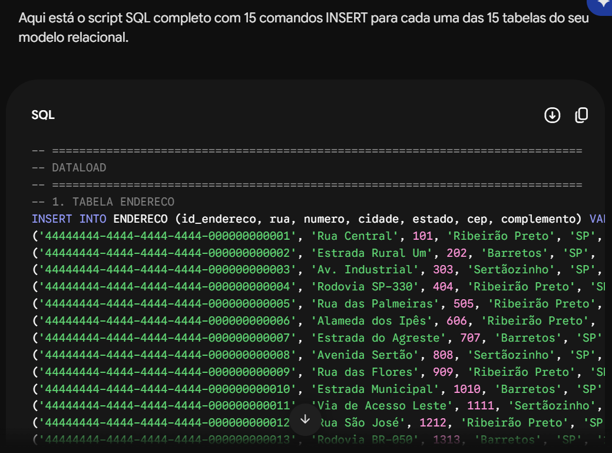

- Justificativa do uso: O uso da IA na criação do script de *dataload* serviu para agilizar o trabalho e gerar dados fictícios para testes com mais rapidez. A ferramenta ajudou a montar os comandos de banco de dados sem erros de digitação e no formato correto. Com isso, a equipe economizou tempo e pôde focar nas partes mais importantes e estratégicas do projeto.

### 4.2

- Data: 04/03/2026

- Ferramenta: Gemini

- Tarefa: Contribuição com ideias de soluções digitais que se relacionam com tópicos do ODS 12

- Prompt:

  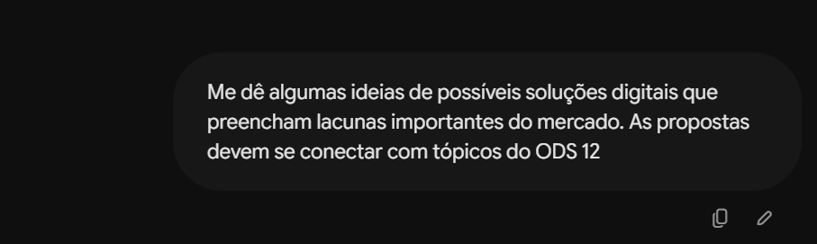

- Resposta:

  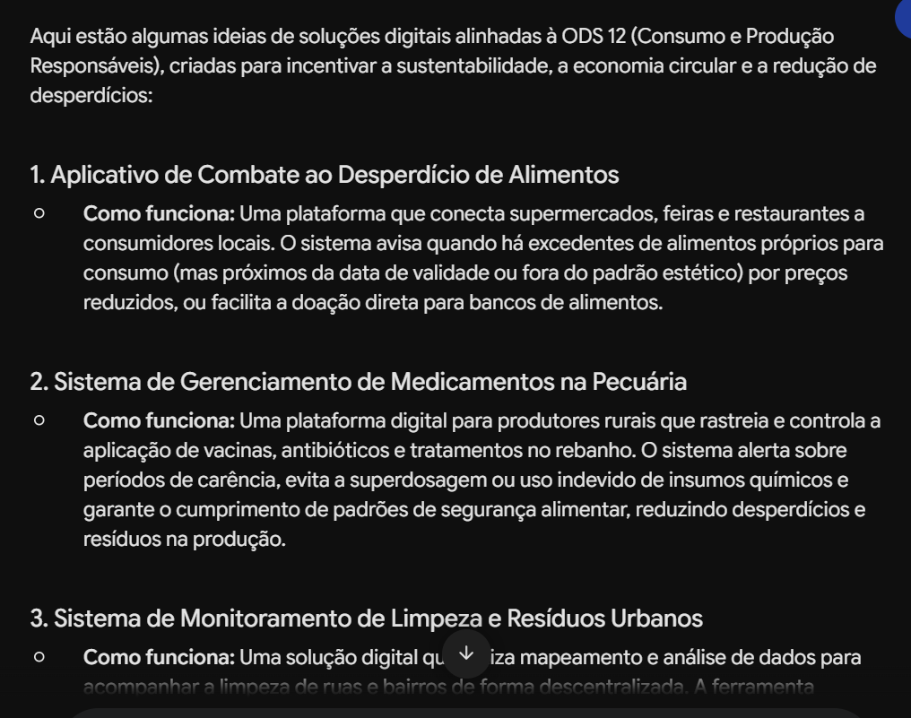

- Justificativa do uso: A contribuição com ideias de soluções digitais que se relacionam com tópicos do ODS 12, fez a equipe explorar diferentes possíveis caminhos para o desenvolvimento do projeto. Obs: O tópico 2 fornecido pela IA foi utilizado como base para o aprimoramento da ideia.

### 4.3

- Data: 03/10/2026

- Ferramenta: ChatGPT

- Tarefa: Explicação de diferentes tipos de animação de botões em CSS

- Prompt:

  

- Resposta:

  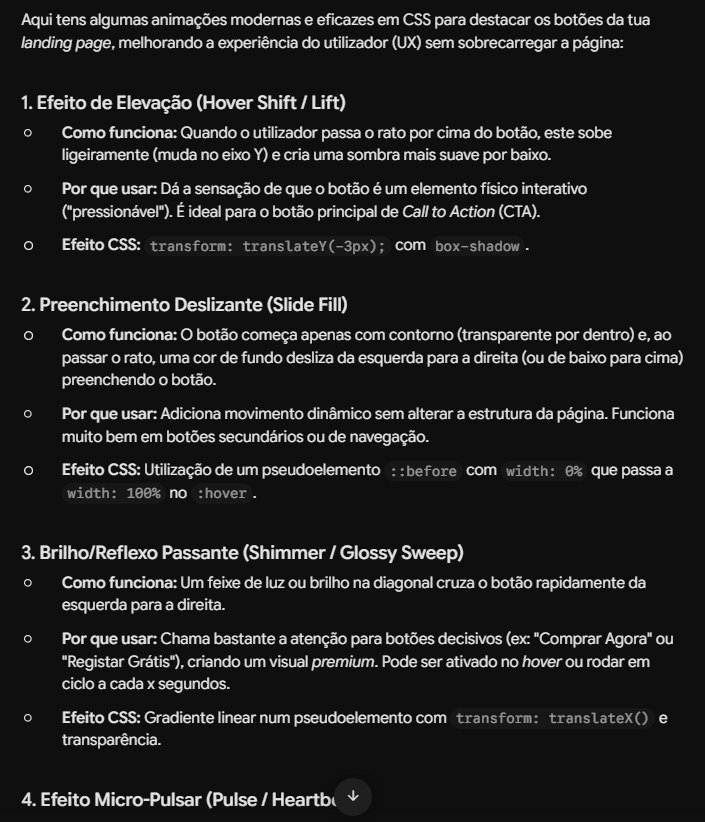

- Justificativa do uso: A ferramenta ajudou para a compreensão mais rápida para a aplicação de animações que deixam a experiência do usuário significativamente superior e mais fluida.

### 4.4

- Data: 06/10/2026

- Ferramenta: Gemini

- Tarefa: Correção de pequenos erros no código HTML da landing, que a integrante não estava conseguindo identificar

- Prompt:

  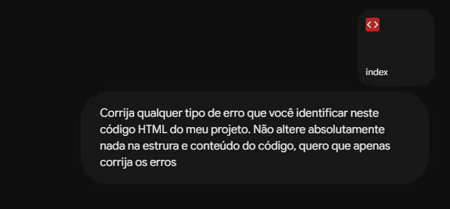

- Resposta:

  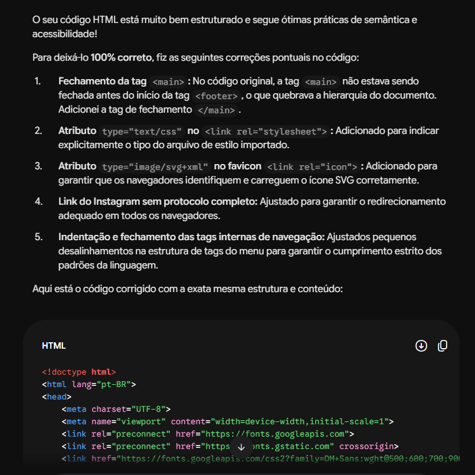

- Justificativa do uso: A IA foi utilizada para revisar o código HTML garantindo que nada passasse batido, como tags abertas ou detalhes de sintaxe. Ela ajudou a encontrar pequenos ajustes na estrutura de forma direta, economizando tempo de testes manuais.

### 4.5

- Data: 16/05/2026

- Ferramenta: Gemini

- Tarefa: Fornecimento de estudos sobre o problema que o mercado pecuário enfrenta com o gerenciamento inadequado de medicamentos

- Prompt:

  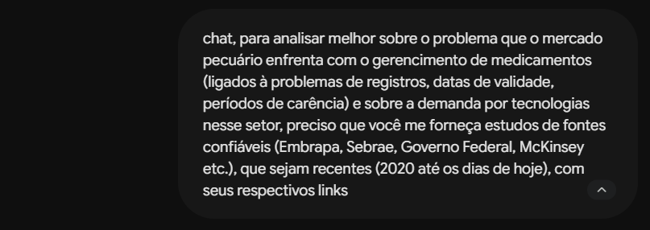

- Resposta:

  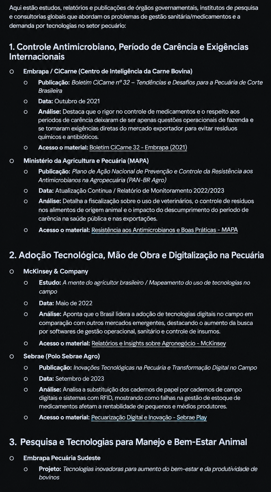

- Justificativa do uso: A IA forneceu os estudos e seus respectivos links. Ter o acesso direto aos links dos estudos otimiza significativamente o tempo de pesquisa, eliminando a necessidade de navegar por diversas páginas de busca até encontrar o documento correto. Em vez de abrir muitas abas e verificar manualmente a veracidade de cada fonte, o caminho para o arquivo original é disponibilizado de forma imediata. Essa praticidade simplifica o processo de coleta de dados e permite direcionar o foco diretamente para a leitura, análise e aplicação do conteúdo.

### 4.6

- Data: 05/10/2026

- Ferramenta: Claude

- Tarefa: Explicação do funcionamento das páginas JSP com os comandos JAVA mais utilizados

- Prompt:

  

- Resposta:

  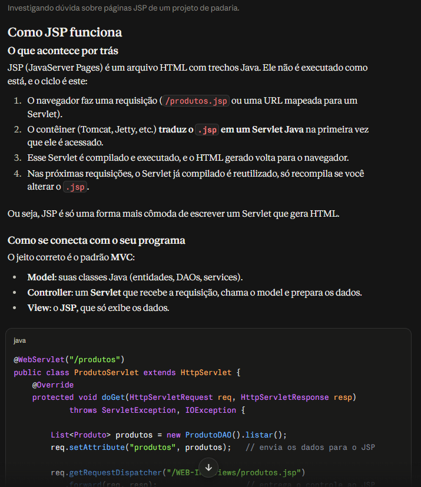

- Justificativa do uso: A IA forneceu explicações claras e exemplos que posso aplicar direto no projeto, o que me poupou tempo de pesquisa e me ajudou a evitar erros comuns de quem está começando.

### 4.7

- Data: 22/09/2026

- Ferramenta: Gemini

- Tarefa: Organização do script SQL, com comentários padronizados e espaçamento mais agradável visualmente nas tabelas

- Prompt:

  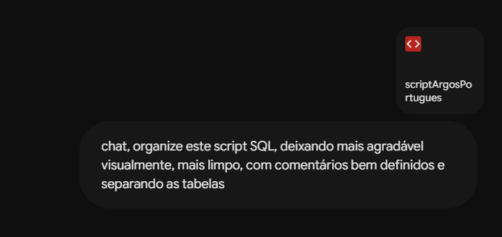

- Resposta:

  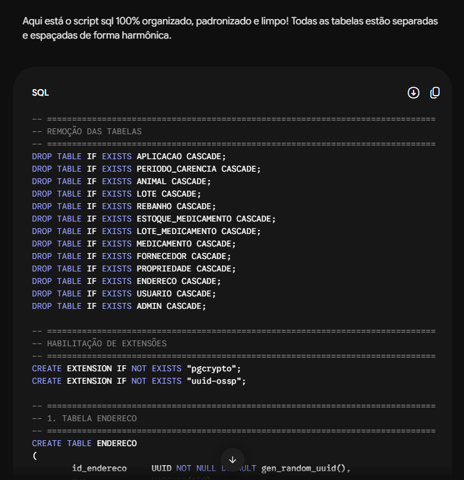

- Justificativa do uso: Usar IA para organizar esse código vale a pena porque economiza tempo em uma tarefa puramente braçal. Ela preserva 100% da lógica e do conteúdo original, cuidando só de alinhar os comentários, ajustar os espaçamentos e deixar as tabelas separadas de forma limpa. O resultado é um script mais legível e agradável de manter, sem precisar gastar muito tempo com isso.

- Resposta:

  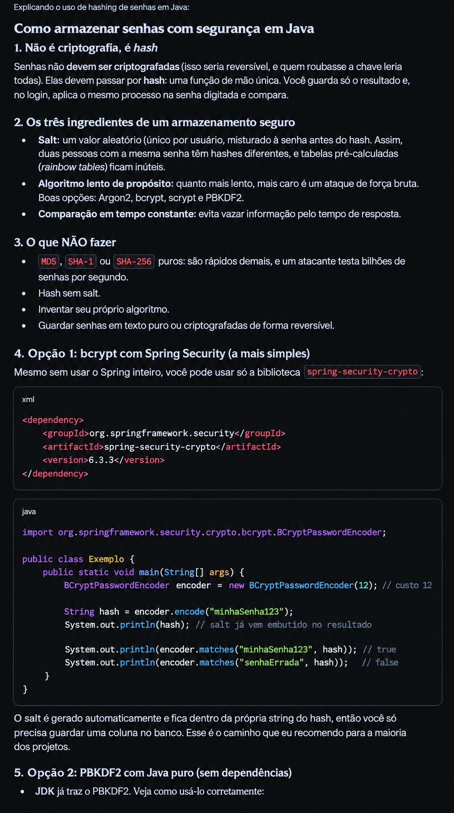

- Justificativa do uso: A ferramenta consegue auxiliar de maneira significativamente quando o intuito é aprender sobre algo conceitual de fácil acesso (que não precisa de fontes específicas). Neste caso a IA foi muito importante. Com ela, conseguimos ter essa correção em relação ao por que do hashing não ser uma criptografia.

## 5. Ferramentas Utilizadas

| **Ferramenta / Nome** | **Finalidade**                                                                                                            | **Etapa do Projeto em que foi Utilizada**      |
|-----------------------|---------------------------------------------------------------------------------------------------------------------------|------------------------------------------------|
| **Gemini**            | Ideação de propostas, geração de dados para testes (SQL), revisão de HTML e busca de fontes de pesquisa (Embrapa/Sebrae). | Ideação, Pesquisa, Banco de Dados e Front-end. |
| **ChatGPT**           | Explicação de conceitos e ideias de animações/efeitos em CSS para botões.                                                 | Front-end e UI/UX.                             |
| **Claude**            | Explicações conceituais de arquitetura (JSP/MVC) e conceitos de segurança (hashing de senhas em Java).                    | Estudo de Arquitetura e Back-end.              |

## 6. Validação e Pensamento Crítico

### 6.1. Inconsistências e Erros Identificados:

- **Links ou fontes desatualizadas:** Em algumas pesquisas, a IA chegou a mencionar títulos de matérias ou links que estavam quebrados ou não levavam diretamente ao PDF oficial.

- **Sugestões de código genéricas:** Em alguns trechos de CSS e Java, a IA sugeriu bibliotecas externas mais complexas do que precisávamos para o escopo do nosso projeto acadêmico.

### 6.2. Processo de Validação:

- **Conferência de Fontes:** Todos os links fornecidos foram acessados manualmente para confirmar se os dados da Embrapa, Sebrae e MAPA eram reais.

- **Testes no Código:** Nenhuma linha de SQL ou HTML gerada foi usada sem ser testada antes no banco de dados local ou no navegador para ver se funcionava perfeitamente.

### 6.3. Correções e Complementações:

- **Ajustes nos Scripts:** Adaptamos os dados fictícios gerados no DATALOAD para garantirmos que os nomes de cidades, estados e CEPs fossem condizentes com a nossa região.

- **Simplificação de Códigos:** Filtramos as explicações do Claude/ChatGPT e aproveitamos apenas os trechos de Java e CSS que faziam sentido para a nossa estrutura simples.

### 6.4. Limitações Percebidas:

A IA não entende o contexto completo do projeto se você não explicar muito bem no prompt. Muitas vezes as respostas eram genéricas e exigiam que a gente fizesse perguntas mais específicas para chegar no resultado desejado.

## 7. Reflexão Crítica sobre IA

### 7.1. Obstáculos e Situações em que a IA Atrapalhou:

Quando pedimos sugestões muito abertas, a IA trouxe opções demais, o que acabou tirando um pouco o nosso foco e fazendo a gente perder tempo decidindo qual caminho seguir. Além disso, tentar colar um código gigante e pedir para "arrumar tudo" costumava gerar respostas confusas, sendo melhor pedir ajuda em partes menores.

### 7.2. O que NÃO Deve Ser Delegado à IA no Projeto Argos:

- A definição de como o sistema deve funcionar no dia a dia da pecuária exige entendimento real do problema, para isso, foram dedicadas muitas horas de pesquisa em fontes confiáveis e específicas.

- O raciocínio por trás do código e a conexão entre o Back e o banco de dados.

- A escolha final da identidade visual e da usabilidade.

- Estrutura das tabelas do banco de dados.

- Gestão do projeto com ferramentas (Excel e Jira).

### 7.3. Riscos Éticos e Sociais:

No contexto da pecuária e saúde animal, confiar cegamente em informações geradas por IA sobre períodos de carência ou dosagem de remédios pode causar sérios riscos à saúde pública (como resíduos de medicamentos na carne).

## 8. Segurança, Privacidade e Responsabilidade

### 8.1. Tratamento de Dados Pessoais:

**Dados dos Usuários/Produtores Rurais:** Nome completo, e-mail, telefone de contato e senha de acesso. Esses dados são necessários para a criação do perfil, autenticação na plataforma e comunicação.

**Dados das Propriedades Rurais:** Endereço da propriedade (rua, número, cidade, estado e CEP) e dados do rebanho. Conforme estruturado nas tabelas do nosso banco de dados (como a tabela ENDERECO e USUARIO), essas informações servem para vincular o produtor ao seu lote de animais e ao controle de medicamentos.

Esses dados são armazenados na nossa base PostgreSQL apenas para permitir o funcionamento das funcionalidades do sistema (como emitir alertas de vencimento de remédios e controle de períodos de carência por propriedade). Não há coleta de dados sensíveis (como biometria ou dados financeiros) e nenhuma informação pessoal dos usuários foi inserida nos prompts das ferramentas de IA durante os nossos testes.

### 8.2. Medidas de Proteção da Informação:

- **Validação de CPF:** Aplicamos uma validação (Regex) no Backend do projeto para garantir que o CPF do usuário esteja no formato numérico correto e limpo antes de ser processado pelo sistema.

- **Armazenamento Seguro de Senhas:** Conforme estudado com o auxílio do Claude, as senhas dos usuários nunca são salvas em texto puro no banco de dados, sendo utilizado *hashing* seguro.

- **Privacidade nos Prompts:** Não enviamos dados reais ou sensíveis de pessoas/empresas nos prompts de busca das IAs.

### 8.3. Conformidade com a LGPD:

O projeto segue os princípios da LGPD ao praticar a minimização de dados, ou seja, coletando apenas as informações estritamente necessárias para o sistema funcionar, como CPF, nome, e-mail, telefone, endereço da propriedade e dados do rebanho, sem pedir nada excessivo ou desnecessário. Para garantir a segurança de tudo, aplicamos uma validação com expressão regular (Regex) no back-end para verificar o formato correto do CPF antes de salvar no banco de dados, protegemos as senhas dos usuários usando técnicas de hashing com salt, o que evita acessos não autorizados, e tomamos o cuidado de nunca enviar dados pessoais de pessoas reais nos testes com as ferramentas de inteligência artificial.

### 8.4. Riscos de Uso Inadequado da IA:

O uso indevido da Inteligência Artificial no projeto traz riscos sérios, como a possibilidade de gerar dados falsos para relatórios, aceitar códigos sem revisão que criem falhas de segurança no banco de dados, ou tomar decisões sanitárias sem embasamento. No setor da pecuária, confiar cegamente na IA para calcular prazos de carência ou dosagens de remédios sem o aval de um médico-veterinário pode prejudicar a saúde dos animais e contaminar alimentos que chegam ao consumidor. Para prevenir esses problemas e evitar o uso irresponsável, a equipe utiliza a IA estritamente como apoio de estudos e produtividade, garantindo que todas as respostas e códigos passem por testes manuais, checagem de fontes e validação antes de qualquer aplicação.

## 9. Conclusão Final

A experiência de utilizar ferramentas de Inteligência Artificial no Projeto Argos mostrou que a tecnologia é uma excelente aliada para acelerar o aprendizado, tirar dúvidas de programação e agilizar tarefas operacionais do dia a dia. No entanto, ficou claro para a equipe que a IA funciona apenas como um assistente de apoio: o entendimento das regras de negócio, a segurança dos dados e as decisões finais do projeto continuam dependendo 100% do raciocínio crítico, da pesquisa em fontes confiáveis e da validação humana. Usar a IA de forma ética e consciente nos permitiu entregar uma solução mais bem estruturada, sem abrir mão do nosso próprio aprendizado e da responsabilidade com o projeto.
